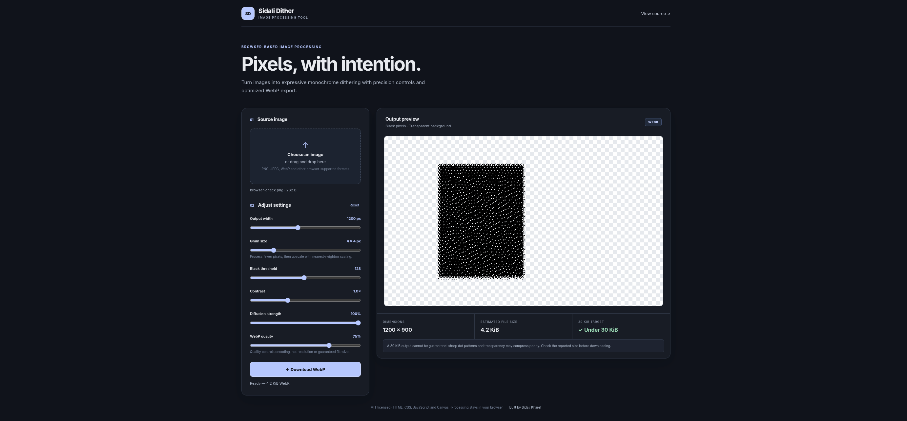

# Sidali Dither

Turn images into expressive monochrome dithering with precision controls and optimized WebP export. Sidali Dither is a small, dependency-free image processing utility that runs entirely in the browser.



## Features

- Load an image by selecting a file or dragging it onto the upload area.
- Adjust output width, grain size, black threshold, contrast, diffusion strength, and WebP quality.
- Apply Floyd–Steinberg error diffusion using floating-point luminance values.
- Keep black pixels opaque and make white pixels transparent.
- Preview the result over a transparency checkerboard and inspect its actual dimensions and encoded size.
- Download browser-encoded WebP only when the encoder returns a valid WebP blob.
- Process images locally; no upload, server, or external runtime dependency is used.

## Getting started

The app uses JavaScript modules, so serve the project over HTTP instead of opening `index.html` directly:

```sh
python3 -m http.server 8000
```

Open [http://localhost:8000](http://localhost:8000) in a supported browser.

## Dithering and grain size

The source is resized to the requested output dimensions while preserving its aspect ratio. The app then reduces that image to a logical grid based on the grain-size setting, applies Floyd–Steinberg error diffusion, and scales the result back to the requested dimensions using nearest-neighbor interpolation.

For each logical pixel, luminance is adjusted by the contrast setting and quantized to black or white at the selected threshold. The quantization error is distributed to the right (7/16), bottom-left (3/16), below (5/16), and bottom-right (1/16). Calculations use a `Float32Array` so fractional error is retained rather than clamped during processing. The diffusion-strength setting scales the amount of error propagated.

Fully transparent source pixels are composited against white for luminance calculation. The output contains opaque black pixels or fully transparent pixels; it does not create partially transparent dots.

## WebP export and size target

Export uses the browser Canvas API. The app checks the returned blob MIME type and reports an error instead of labeling a different format as WebP when encoding is unavailable. The displayed file size is the encoded blob's actual size.

The 30 KiB indicator is a target, not a guarantee. File size depends on image content, dimensions, grain pattern, and browser encoder. The quality control changes encoder quality but cannot guarantee a particular file size.

## Browser support

Use a modern browser with Canvas 2D, ES modules, `createImageBitmap` (or image-element decoding), and `canvas.toBlob()` WebP encoding. Browser-specific canvas limits may restrict unusually large images.

## Project structure

```text
.
├── assets/
│   └── favicon.svg
├── index.html
├── main.js
├── core.mjs
├── styles.css
├── tests/
│   └── core.test.mjs
├── README.md
└── LICENSE
```

## Development and tests

No package installation or build step is required. Run the core tests and syntax checks with Node.js:

```sh
node --test tests/*.test.mjs
node --check main.js
node --check core.mjs
```

## License

Released under the MIT License. See [LICENSE](./LICENSE).

## Author

Built by [Sidali Kharef](https://github.com/sidalikharef).

[Website](https://sidalikharef.cc/)
