<div align="center">


<h1>Sidali DitherLab</h1>

<p><strong>Every Pixel, Perfected.</strong></p>

<p>A privacy-first monochrome and full-color dithering studio for creating and comparing pixel artwork in your browser.</p>

<p>
  <a href="https://ditterlab.sidalikharef.cc/">Live Demo</a> ·
  <a href="https://sidalikharef.cc/">Portfolio</a> ·
  <a href="https://github.com/sidalikharef">GitHub</a> ·
  <a href="https://www.linkedin.com/in/sid-ali-kharef-b5195419b/">LinkedIn</a>
</p>


</div>

---

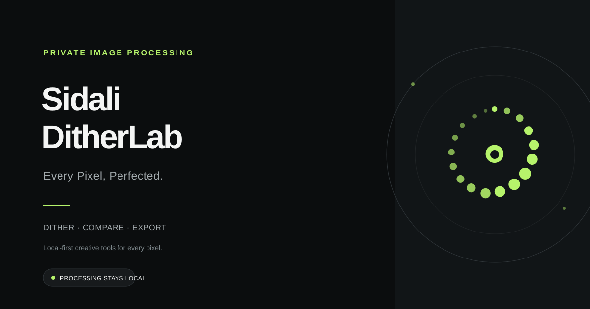

## ✨ Overview

**Sidali DitherLab** is a lightweight, privacy-first image-processing application built with vanilla JavaScript, HTML, and CSS. Its reusable engine supports monochrome output and full-color palette dithering without uploading images or palettes.

It provides nine monochrome and full-color dithering algorithms, six monochrome presets and eight color presets, algorithm/palette comparisons, adjustable processing controls, worker-backed previews, batch conversion, and format-aware exports.

Everything runs locally in your browser. Your images are processed on your device without being uploaded to a server.

Designed for developers, digital artists, designers, and anyone interested in experimental image processing.

### 🌐 Try It Online

**[Launch Sidali DitherLab →](https://ditterlab.sidalikharef.cc/)**

No installation, account, or image upload to a server required.

## 📸 Screenshots

| Editor — Dark Theme | Editor — Light Theme |
|---|---|
| 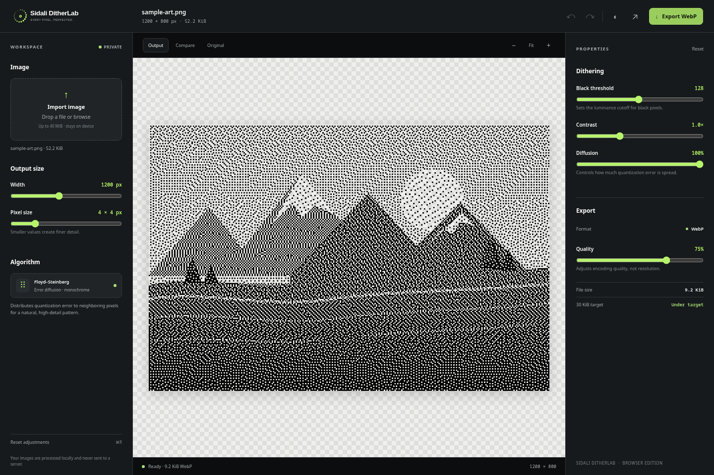 | 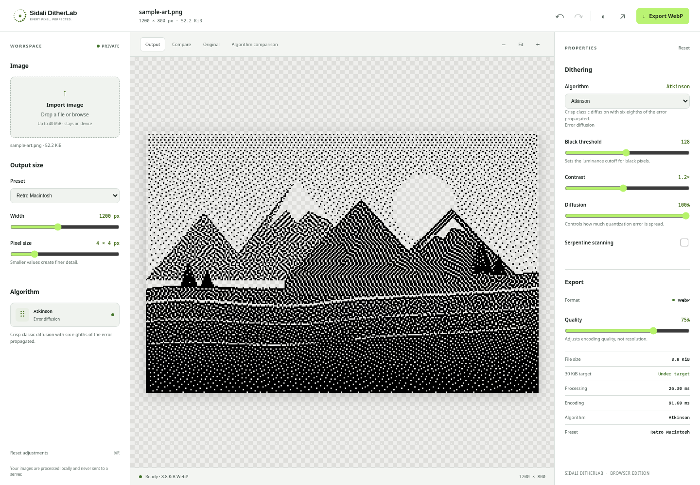 |

| Algorithm Comparison | Color Palette Studio |
|---|---|
| 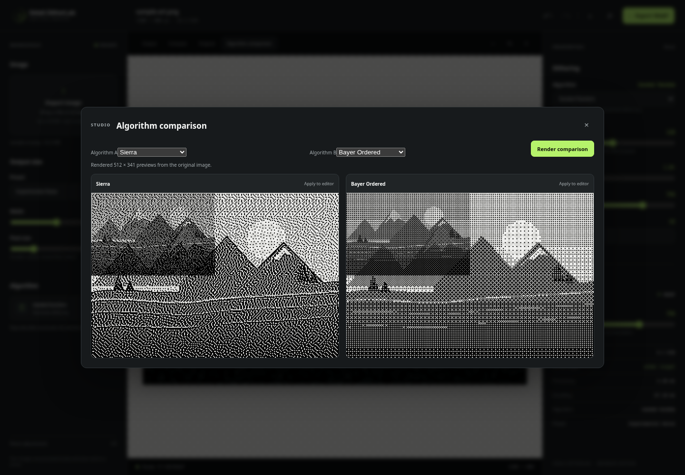 | 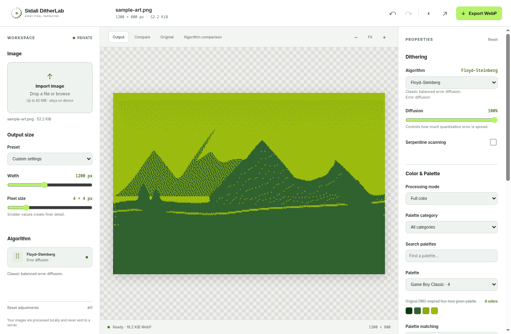 |

| Game Boy Palette | Custom Palette Editor |
|---|---|
| 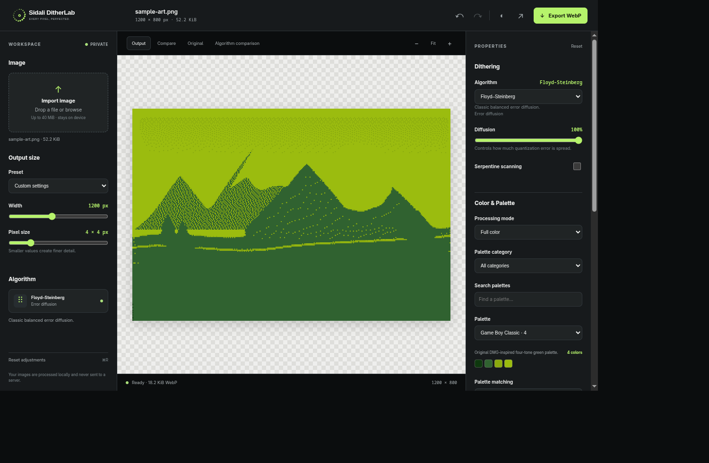 | 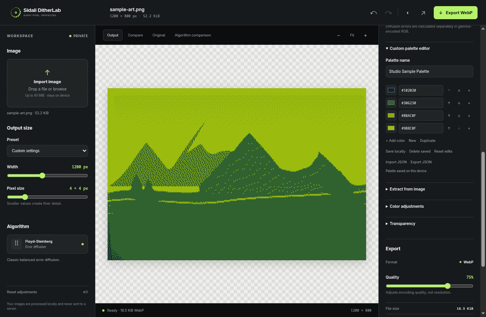 |

| Palette Comparison | Mobile Color Studio |
|---|---|
| 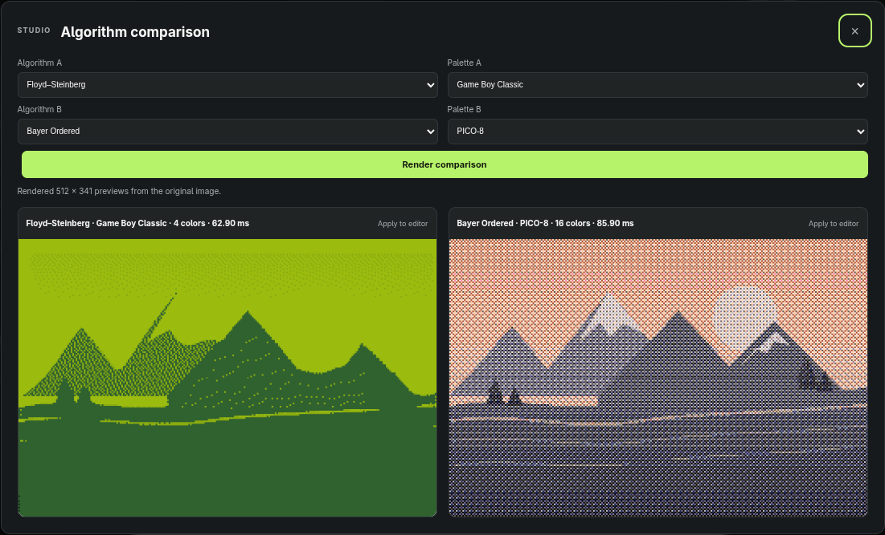 | 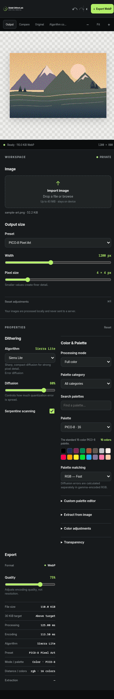 |

| Worker Processing | Advanced Export |
|---|---|
| 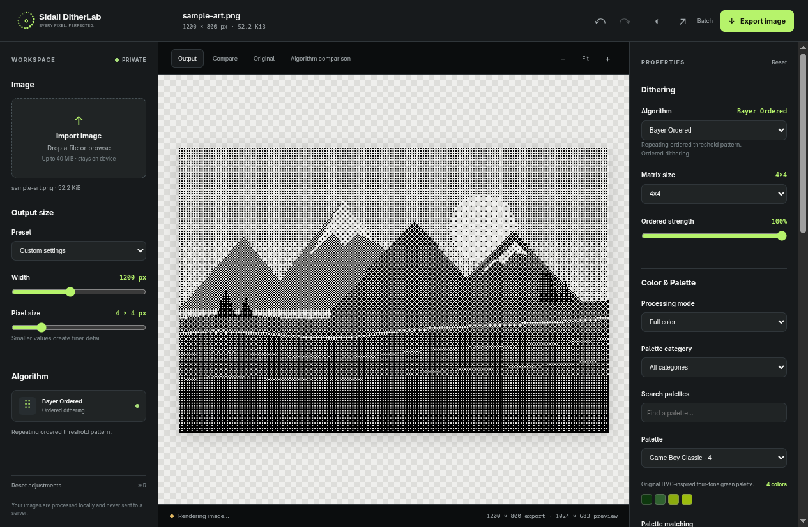 | 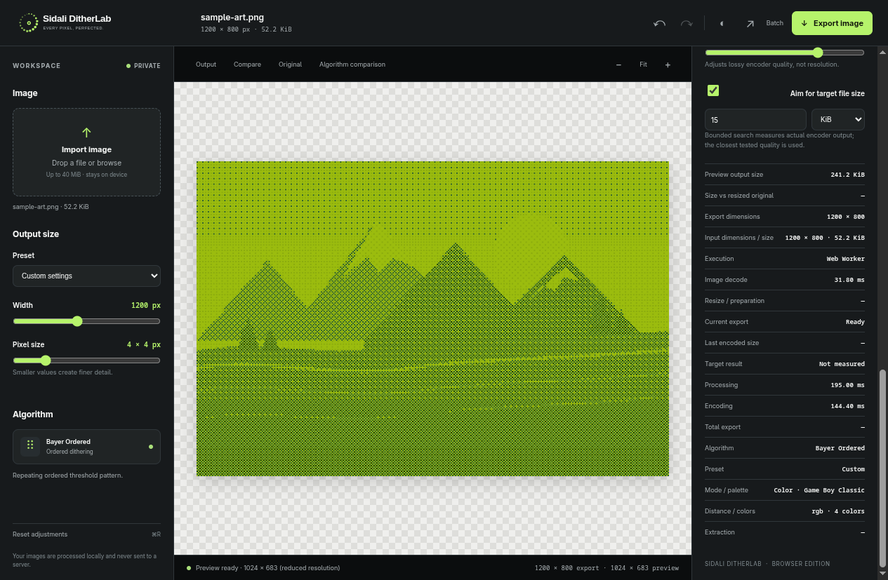 |

| Batch Workspace | Batch Processing |
|---|---|
|  | 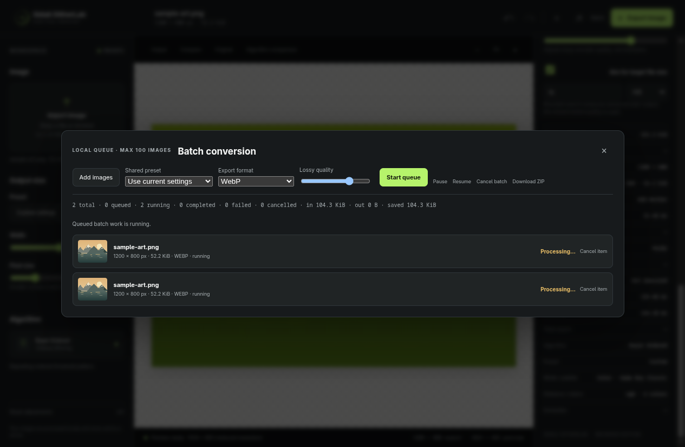 |

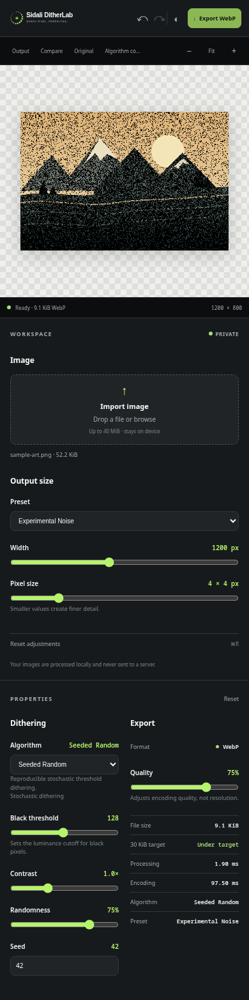

> Screenshots show the actual application and repository sample artwork. The batch screenshots show queued and actively processing states, not a completed archive.

## ⚡ Features

### 🎨 Image Processing

- **Nine algorithms:** Floyd–Steinberg, Atkinson, Jarvis–Judice–Ninke, Stucki, Burkes, Sierra, Sierra Lite, Bayer Ordered, and Seeded Random.
- **Algorithm selector:** Algorithms are grouped by error-diffusion, ordered, and stochastic families, with descriptions and relevant controls.
- **Algorithm-specific controls:** Error-diffusion strength and optional serpentine scan; Bayer 2×2, 4×4, and 8×8 matrices and ordered strength; seeded random value and randomness strength.
- **Built-in presets:** Classic Mono, Retro Macintosh, Newspaper Texture, Soft Diffusion, Sharp Pixel Mono, and Experimental Noise.
- **Algorithm comparison:** Render two algorithms from the same original image at a bounded preview resolution and apply either result to the editor.
- **Processing metrics:** Worker algorithm time, decode duration, resize/preparation duration, preview and full-resolution dimensions, input bytes, encoding duration, total export time, measured encoded size, and comparison against a same-dimension encoded source.
- **Color metrics:** Current mode, palette and color count, matching metric, and the measured duration of the most recent extraction.
- **Adjustable output dimensions:** Resize images while preserving their aspect ratio.
- **Pixel-size control:** Create fine-grained dithering or bold pixelated styles.
- **Black threshold:** Control the balance between black and transparent pixels.
- **Contrast adjustment:** Fine-tune image detail before quantization.
- **Diffusion strength:** Adjust how quantization error spreads between pixels.
- **Transparency support:** Generate opaque black pixels on a transparent background.
- **Full-color mode:** Quantize original image pixels to a selected palette using Floyd–Steinberg, Atkinson, Jarvis–Judice–Ninke, Stucki, Burkes, Sierra, Sierra Lite, Bayer, or seeded random dithering.
- **Palette library:** Browse 19 built-in palettes in Classic, Retro Computing, Artistic, and Technical categories, including Game Boy Classic, CGA, Commodore 64, PICO-8, RGB332, and Web-safe.
- **Color matching:** Choose RGB — Fast, Linear RGB — Light-aware, or CIELAB ΔE76 — Perceptual. These are explicit distance measures, not claims of universally optimal perception.
- **Palette editing:** Create, name, duplicate, reorder, edit HEX or native color values, and add or remove unique colors. Custom palettes support 2–256 colors, JSON import/export, and versioned localStorage persistence.
- **Palette extraction:** Generate local palettes with deterministic Median Cut or seeded K-Means from a bounded representative sample of up to 50,000 visible pixels.
- **Color adjustments:** Apply brightness, contrast, saturation, gamma, exposure, hue, temperature, and tint non-destructively to the decoded source before quantization.
- **Alpha handling:** Preserve source alpha, composite onto a chosen background, or emit opaque palette-mapped pixels. Fully transparent pixels are excluded from preserved-mode diffusion.
- **Color presets:** Game Boy Classic, Retro CGA, 1-Bit Newspaper, PICO-8 Pixel Art, Warm Duotone, Sunset Dither, Adaptive 8-Color, and High-Contrast Poster.
- **Palette comparison:** Compare algorithm and palette combinations from the same original; choose the same algorithm with two palettes or different algorithms with a shared palette.
- **Worker-backed processing:** Interactive previews, algorithm comparisons, and explicit palette extraction use native module workers when available. Jobs use transferable pixel buffers, bounded priority scheduling, and stale-preview cancellation; a main-thread engine fallback remains available.
- **Resolution-aware previews:** Previews are capped at 1024 pixels on the longest side and reuse the decoded source. Exports reprocess original pixels at the configured output dimensions instead of enlarging the preview.
- **Batch conversion:** Queue up to 100 images and 200 MiB of source files, choose a shared processing preset and output format, pause/resume scheduling, cancel or retry items, and download completed results individually or as a ZIP. Batch output retention is capped at 256 MiB.
- **Advanced export:** Export PNG, JPEG, or WebP; AVIF is enabled only when the browser's Canvas encoder returns a verified AVIF blob. JPEG transparency is composited on the selected background. Lossy quality controls are hidden for PNG.
- **Target-size search:** For adjustable-quality formats, measure up to eight actual encodes and select the closest tested result. This bounded search does not guarantee a target; PNG does not support quality-based size search.

### 🖥️ Professional Editor

- Modern Graphite + Electric Lime interface.
- Dark and light themes.
- Image upload through file picker or drag and drop.
- Interactive original/output comparison slider.
- Original, processed, and comparison views.
- Side-by-side output comparison.
- Hold-original preview mode.
- Zoom in, zoom out, fit-to-screen, and actual-size controls; space plus drag pans.
- Undo and redo adjustment changes with coalesced rapid slider commits.
- Reset settings to defaults.
- Transform orientation with counter-clockwise/clockwise rotation, 180° rotation, horizontal or vertical flip, and reset.
- Adjustments for brightness, contrast, saturation, exposure, gamma, hue, grayscale, and inversion before quantization.
- Built-in and locally saved editor presets, plus preset JSON import/export.
- Versioned local session persistence for settings, geometry, view, and theme.
- Keyboard shortcuts for undo/redo, open/save/export, zoom, fit, actual size, pan, and help.
- Responsive layouts for desktop and mobile.

### 📦 Image Optimization

- PNG, JPEG, and WebP export, plus AVIF only when runtime encoding is verified.
- Adjustable quality for supported lossy formats; JPEG uses a selectable compositing background.
- Optional bounded target-size quality search for lossy formats.
- Actual encoded file-size reporting.
- Output dimension information.
- Batch export with individual downloads and a standards-compliant ZIP archive.
- Browser-based image processing.
- No third-party runtime dependencies.

### 🔒 Privacy First

- No account required.
- No server-side image processing.
- No image uploads.
- No mandatory cloud services.
- Image processing happens in the browser.

**Input limits:** 40 MiB per image file and 50 megapixels. Full-resolution export output is limited to 20 megapixels for browser memory safety.

## 🚀 Getting Started

### Option 1 — Use the Online Studio

Open the live application:

**https://ditterlab.sidalikharef.cc/**

Upload an image, adjust the dithering parameters, compare the result, and export your optimized artwork.

### Option 2 — Run Locally

Clone the repository:

```bash
git clone https://github.com/sidalikharef/js-image-dithering-converter-and-compression.git
```

Navigate into the project:

```bash
cd js-image-dithering-converter-and-compression
```

Start a local development server (Python 3 is sufficient):

```bash
python3 -m http.server 8000
```

Open:

**http://localhost:8000**

Because the application uses native JavaScript ES modules, it must be served over HTTP rather than opened directly through the `file://` protocol.

No `npm install`, build process, or external runtime dependencies are required to run the web application.

## 🧠 How Dithering Works

Sidali DitherLab always processes the decoded original image rather than feeding a previous dithered output back into the engine:

The processing pipeline follows these steps:

1. Resize the original image to the requested output dimensions while preserving its aspect ratio.
2. Reduce the image to a logical pixel grid.
3. Calculate pixel luminance and apply contrast.
4. Quantize each pixel into black or transparent with the selected algorithm.
5. Apply the selected error-diffusion kernel, Bayer ordered threshold matrix, or seeded stochastic threshold.
6. Scale the result using nearest-neighbor interpolation.
7. Encode the final image as WebP.

### Error Diffusion Matrix

Error-diffusion kernels include Floyd–Steinberg (16), Atkinson (6/8 propagated error), Jarvis–Judice–Ninke (48), Stucki (42), Burkes (32), Sierra (32), and Sierra Lite (4). Optional serpentine scanning mirrors horizontal kernel offsets on alternate rows.

The Floyd–Steinberg kernel distributes error according to:

```text
             X    7/16
    3/16    5/16  1/16
```

Where `X` represents the currently processed pixel.

Fractional error is preserved using a `Float32Array`, preventing premature clamping during diffusion.

The diffusion-strength setting controls how much error is propagated. Bayer uses a repeating 2×2, 4×4, or 8×8 threshold matrix; its ordered-strength control blends to ordinary thresholding at zero. Seeded Random uses a deterministic PRNG, so the same input and seed reproduce the same output.

Fully transparent source pixels are composited against white for luminance calculations.

The resulting image contains opaque black pixels and fully transparent pixels, without partially transparent dots.

## 🌈 Full-Color Palette Studio

Switch **Processing mode** to **Full color** to use an independent RGB palette pipeline. The selected algorithm maps each adjusted source pixel directly to an exact palette entry; error diffusion operates on floating-point RGB channel errors, while palette matching uses the independently selected RGB, linear-light RGB, or CIELAB ΔE76 metric. RGB Euclidean distance uses gamma-encoded 8-bit channel values; Linear RGB uses normalized linear-light sRGB; Lab distance is Euclidean ΔE76 with sRGB converted to CIELAB using the D65 reference white and 2° standard observer. Thus the selected matching space is never confused with the RGB space used by the diffusion kernels.

Color Bayer adds a repeating, zero-mean spatial RGB offset before palette matching. Strength zero is plain palette quantization. Seeded Random applies deterministic shared-channel noise before matching; zero strength is also plain quantization. The seven error-diffusion algorithms retain their existing kernels and optional serpentine scanning. No CSS filter is used as a processing substitute.

Built-in Commodore 64 colors use the common Pepto RGB palette variant; CGA uses the classic 16-entry RGBI color set assembled across display modes. The Game Boy Classic palette is a DMG-inspired four-tone set. Artistic palette colors are original selections. Palette matching can produce only the palette colors; preserved fully transparent pixels remain transparent. Partial alpha is retained in Preserve mode. Composite mode blends against the selected background in sRGB code values before adjustments; Opaque mode uses that same background for transparent portions and emits opaque pixels. Hidden RGB values in fully transparent pixels are therefore ignored in both modes.

Color adjustments are applied to a fresh sample of the original on every render, in this order: decode sRGB to linear RGB; apply exposure; apply contrast and brightness; adjust saturation; rotate hue; apply temperature and tint offsets; apply grayscale; apply gamma; encode back to sRGB; then apply inversion. Brightness and temperature/tint ranges are normalized offsets; exposure uses EV stops; hue is degrees; gamma is a positive exponent control. Grayscale and inversion are explicit boolean controls. Adjustments never modify the uploaded image.

The palette library is local and versioned. User-created palettes are stored under `sidali-ditherlab:custom-palettes:v1` in the current browser profile. Palette imports use a bounded, versioned JSON schema and are treated as data only. No image or palette information is sent to a service.

Median Cut splits sampled boxes by the largest channel range and uses each box's mean. K-Means uses seeded initialization, a bounded iteration count, and sampled RGB pixels; it is deterministic for fixed inputs and settings but does not guarantee a globally optimal palette. Fully transparent pixels are excluded from extraction. Uniform or limited-color images may yield fewer colors than requested.

## 📤 Export and Compression

Images are encoded through the browser Canvas API using WebP.

Monochrome controls include:

- Output width.
- Pixel size.
- WebP quality.
- Contrast.
- Threshold.
- Diffusion strength.

The application validates the encoded blob's MIME type to avoid incorrectly labeling an unsupported format as WebP.

The reported output size is based on the actual encoded blob.

**Note:** The 30 KiB indicator is a target, not a guaranteed output size. Compression efficiency depends on source content, dimensions, dithering patterns, and browser encoding behavior.

## 🏗️ Project Structure

The application is built with native JavaScript ES modules and has no runtime or development package dependencies. The algorithm registry connects the nine monochrome and color-processing choices to shared validation, quantization, luminance, seeded-random, and error-diffusion utilities. Color-space conversion and distance calculations are isolated from palette validation, extraction, and quantization. The browser UI in `main.js` connects those modules to the editor controls and Canvas-based image pipeline. Node.js's built-in test runner exercises the engine, and separate scripts benchmark monochrome algorithms and color processing.

```text
sidali-ditherlab/
├── assets/
│   ├── dither-orbit.svg
│   ├── dither-orbit-light.svg
│   ├── dither-orbit-lockup-dark.svg
│   ├── dither-orbit-lockup-light.svg
│   ├── favicon.svg
│   ├── sample-art.png
│   ├── sample-art.svg
│   ├── social-preview.svg
│   ├── social-preview.png
│   └── screenshots/
│       ├── editor-dark.png
│       ├── editor-light.png
│       ├── compare-view.png
│       ├── mobile-editor.png
│       ├── algorithm-comparison.png
│       ├── color-studio.png
│       ├── gameboy-palette.png
│       ├── custom-palette.png
│       ├── palette-comparison.png
│       ├── mobile-color-studio.png
│       ├── worker-processing.png
│       ├── advanced-export.png
│       ├── batch-workspace.png
│       └── batch-processing.png
├── tests/
│   ├── fixtures/algorithm-images.mjs
│   ├── core.test.mjs
│   ├── engine.test.mjs
│   ├── color.test.mjs
│   ├── phase-e.test.mjs
│   └── editor.test.mjs
├── benchmarks/
│   ├── algorithms.mjs
│   ├── color-processing.mjs
│   ├── worker-performance.mjs
│   └── worker-task.mjs
├── src/
│   ├── engine/
│   │   ├── algorithms/
│   │   ├── color/
│   │   ├── palettes/
│   │   ├── utilities/
│   │   ├── history.mjs
│   │   ├── index.mjs
│   │   ├── presets.mjs
│   │   ├── registry.mjs
│   │   └── validation.mjs
│   ├── editor/
│   │   ├── adjustments.mjs
│   │   ├── pipeline.mjs
│   │   ├── presets.mjs
│   │   ├── preview-scheduler.mjs
│   │   ├── session.mjs
│   │   ├── state.mjs
│   │   └── transforms.mjs
│   ├── workers/
│   │   ├── image-worker.mjs
│   │   ├── job-scheduler.mjs
│   │   ├── worker-client.mjs
│   │   └── worker-protocol.mjs
│   ├── export/
│   │   ├── filename.mjs
│   │   ├── formats.mjs
│   │   └── target-size.mjs
│   ├── batch/
│   │   ├── batch-queue.mjs
│   │   └── zip-writer.mjs
│   └── utilities/
│       ├── performance-metrics.mjs
│       └── resource-manager.mjs
├── index.html
├── main.js
├── core.mjs
├── styles.css
├── package.json
├── README.md
└── LICENSE
```

## 🧪 Development and Testing

The application uses native JavaScript modules and Node.js's built-in testing tools. No dependency installation is required. The test suite covers the modular engine, full-color processing, exports, workers, batch queue, and editor transforms, adjustments, pipeline, presets, session persistence, preview scheduling, and worker operations.

Run the test suite:

```bash
npm test
```

Run syntax checks:

```bash
npm run check
```

The legacy Floyd–Steinberg API remains in `core.mjs` for compatibility. The modular engine in `src/engine` is independent of browser APIs and is tested with Node.js fixtures.

Run the deterministic median benchmark for all algorithms at 256×256, 512×512, and 1024×1024:

```bash
npm run benchmark
```

The benchmark runs one warm-up and three measured iterations per case; it prints measurements from the current machine and does not encode or assert performance claims.

Run color processing and extraction benchmarks:

```bash
npm run benchmark:color
```

This reports median timings for RGB, linear RGB, and Lab image quantization; color Floyd–Steinberg, Atkinson, and Bayer; and sample-bounded Median Cut and K-Means. Extraction uses at most 50,000 sampled visible pixels. Timings are local observations, not performance guarantees.

Compare direct engine calls with transferable-buffer Node worker-thread runs:

```bash
npm run benchmark:workers
```

The worker benchmark reports median direct processing, worker compute, worker end-to-end latency, repeated-job throughput, and busy-worker cancellation-to-termination response at 256², 512², 1024², and 2048² by default. Set `DITHERLAB_BENCH_MAX_SIZE=1024` to cap the largest workload or `DITHERLAB_BENCH_ITERATIONS` to change the measured repeat count. Node worker-thread numbers are an instrumentation comparison, not browser measurements or a promise that workers reduce single-job latency.

## 🗺️ Roadmap

Phase E's core performance and export features are implemented: worker-backed previews, resolution-bounded previews, full-resolution format-aware export, measured target-size search, a bounded batch queue, and ZIP download. The following phases remain future work:

- **Phase F — Developer toolkit:** TypeScript SDK, NPM library, CLI, and monorepo.
- **Phase G — DitherLab experiment workspace:** A dedicated space for future image-processing experiments.
- **Phase H — Sidali AutoLab:** Local-first intelligent optimization agents for exploring image-processing settings.
- **Phase I — Open-source v1.0 release.**

## ⚠️ Current Limitations

- If module workers cannot be created or fail at startup, the existing engine falls back to the main thread; heavy work can then temporarily block the interface. Some setup, Canvas resizing/encoding, and the Adaptive 8-Color preset's small extraction still run on the main thread.
- Full-color image processing is CPU-intensive, especially with larger palettes and Lab matching; benchmark figures are machine-dependent.
- Color calculations assume sRGB channel values and do not preserve embedded ICC profiles or guarantee color-managed output across browsers.
- WebP encoding uses the browser-specific Canvas encoder; supported output and encoding behavior may vary between browsers. Configured WebP quality is lossy, so decoded exports can differ slightly from exact palette RGB values even though the processing buffer and preview use only selected palette entries.
- Algorithm comparison caps the rendered preview's longest side at 512 pixels to keep comparisons responsive.
- Canvas PNG/JPEG/WebP encoding and AVIF support vary by browser. AVIF remains disabled unless an actual test encode returns `image/avif`.
- Target-size search performs at most eight sequential encodes; output sizes can be non-monotonic with quality, and a requested limit may not be met.
- Batch work is limited to 100 images, 200 MiB of total input, 20 megapixels per output, and 256 MiB of retained output. ZIP output uses uncompressed stored entries, is limited to 256 MiB and classic ZIP bounds, and temporarily allocates archive memory.
- PNG export is lossless but exposes no browser-controlled compression-quality setting. JPEG is opaque after background compositing; WebP may be lossy.
- The interactive preview is capped at 1024 pixels on its longest side; export independently processes the full selected dimensions.
- Browser Canvas dimensions, memory limits, worker support, and encoder behavior vary.
- A CLI, TypeScript packages, and AI optimization agents are not yet available; see the future roadmap.
- Offline PWA support is not implemented.

## 🤝 Contributing

Contributions, bug reports, feature ideas, and improvements are welcome.

You can participate by opening a GitHub issue, suggesting a new dithering algorithm, reporting a processing bug, or proposing improvements to the editor.

Please keep changes focused, document behavioral changes, and run the available tests before submitting a pull request.

**[View the repository on GitHub](https://github.com/sidalikharef/js-image-dithering-converter-and-compression)**

## 📄 License

Sidali DitherLab is released under the **MIT License**.

See [LICENSE](./LICENSE) for the complete MIT license terms and copyright notices. Any applicable upstream or third-party notices must remain with the code to which they apply.

The current application declares no third-party runtime dependencies.

## 👨‍💻 Author

**Sidali Kharef**

Software Developer & Open-Source Enthusiast

Maintainer of Sidali DitherLab.

| Platform | Link |
|---|---|
| 🌐 Portfolio | [sidalikharef.cc](https://sidalikharef.cc) |
| 💻 GitHub | [github.com/sidalikharef](https://github.com/sidalikharef) |
| 💼 LinkedIn | [Sid Ali Kharef](https://www.linkedin.com/in/sid-ali-kharef-b5195419b/) |
| 🚀 Live Application | [ditterlab.sidalikharef.cc](https://ditterlab.sidalikharef.cc) |

---

<div align="center">

### Every Pixel, Perfected.

Built with JavaScript, creativity, and a passion for image processing.

**[Live Demo](https://ditterlab.sidalikharef.cc)** · **[Portfolio](https://sidalikharef.cc)** · **[GitHub](https://github.com/sidalikharef)** · **[LinkedIn](https://www.linkedin.com/in/sid-ali-kharef-b5195419b/)**

**Open Source · MIT Licensed · Privacy First**

</div>