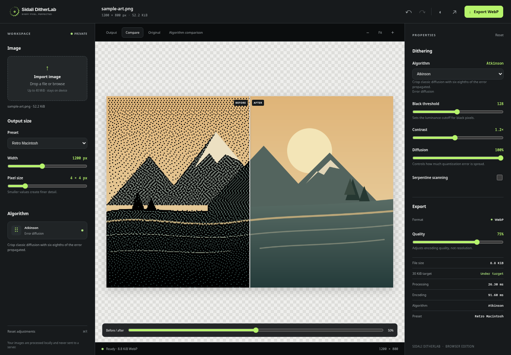

# Sidali DitherLab

<div align="center">


# Every Pixel, Perfected.

**A modern, open-source image dithering and optimization studio.**

Transform images into beautiful monochrome, pixelated artwork with precision controls, real-time comparisons, and privacy-first processing.

[**🚀 Live Demo**](https://ditterlab.sidalikharef.cc) · [**🌐 Portfolio**](https://sidalikharef.cc) · [**💻 GitHub**](https://github.com/sidalikharef)


</div>

---


## ✨ Overview

**Sidali DitherLab** is a lightweight, privacy-first image-processing application built with vanilla JavaScript, HTML, and CSS.

It provides nine monochrome dithering algorithms, six built-in presets, algorithm-to-algorithm and original/output comparisons, adjustable processing controls, and WebP optimization.

Everything runs locally in your browser. Your images are processed on your device without being uploaded to a server.

Designed for developers, digital artists, designers, and anyone interested in experimental image processing.

### 🌐 Try It Online

**[Launch Sidali DitherLab →](https://ditterlab.sidalikharef.cc)**

No installation, account, or image upload to a server required.

## 📸 Screenshots

### Professional Editor — Dark Theme


### Light Theme


### Before & After Comparison



### Responsive Mobile Experience


### Algorithm Comparison


> The screenshots were captured from the actual running application using original sample artwork included in this repository.

## ⚡ Features

### 🎨 Image Processing

- **Nine algorithms:** Floyd–Steinberg, Atkinson, Jarvis–Judice–Ninke, Stucki, Burkes, Sierra, Sierra Lite, Bayer Ordered, and Seeded Random.
- **Algorithm selector:** Algorithms are grouped by error-diffusion, ordered, and stochastic families, with descriptions and relevant controls.
- **Algorithm-specific controls:** Error-diffusion strength and optional serpentine scan; Bayer 2×2, 4×4, and 8×8 matrices and ordered strength; seeded random value and randomness strength.
- **Built-in presets:** Classic Mono, Retro Macintosh, Newspaper Texture, Soft Diffusion, Sharp Pixel Mono, and Experimental Noise.
- **Algorithm comparison:** Render two algorithms from the same original image at a bounded preview resolution and apply either result to the editor.
- **Processing metrics:** Actual algorithm time, separate WebP encoding duration, output dimensions, and encoded file size.
- **Adjustable output dimensions:** Resize images while preserving their aspect ratio.
- **Pixel-size control:** Create fine-grained dithering or bold pixelated styles.
- **Black threshold:** Control the balance between black and transparent pixels.
- **Contrast adjustment:** Fine-tune image detail before quantization.
- **Diffusion strength:** Adjust how quantization error spreads between pixels.
- **Transparency support:** Generate opaque black pixels on a transparent background.

### 🖥️ Professional Editor

- Modern Graphite + Electric Lime interface.
- Dark and light themes.
- Image upload through file picker or drag and drop.
- Interactive original/output comparison slider.
- Original, processed, and comparison views.
- Zoom in, zoom out, and fit-to-screen controls.
- Undo and redo adjustment changes.
- Reset settings to defaults.
- Responsive layouts for desktop and mobile.

### 📦 Image Optimization

- WebP image export.
- Adjustable WebP quality.
- Actual encoded file-size reporting.
- Output dimension information.
- Browser-based image processing.
- No third-party runtime dependencies.

### 🔒 Privacy First

- No account required.
- No server-side image processing.
- No image uploads.
- No mandatory cloud services.
- Image processing happens in the browser.

**Input limits:** 40 MiB per file and 50 megapixels.

## 🚀 Getting Started

### Option 1 — Use the Online Studio

Open the live application:

**https://ditterlab.sidalikharef.cc**

Upload an image, adjust the dithering parameters, compare the result, and export your optimized artwork.

### Option 2 — Run Locally

Clone the repository:

```bash
git clone https://github.com/sidalikharef/js-image-dithering-converter-and-compression.git
```

Navigate into the project:

```bash
cd js-image-dithering-converter-and-compression
```

Start a local development server:

```bash
python3 -m http.server 8000
```

Open:

**http://localhost:8000**

Because the application uses native JavaScript ES modules, it must be served over HTTP rather than opened directly through the `file://` protocol.

No `npm install`, build process, or external runtime dependencies are required to run the web application.

## 🧠 How Dithering Works

Sidali DitherLab always processes the decoded original image rather than feeding a previous dithered output back into the engine:

The processing pipeline follows these steps:

1. Resize the original image to the requested output dimensions while preserving its aspect ratio.
2. Reduce the image to a logical pixel grid.
3. Calculate pixel luminance and apply contrast.
4. Quantize each pixel into black or transparent with the selected algorithm.
5. Apply the selected error-diffusion kernel, Bayer ordered threshold matrix, or seeded stochastic threshold.
6. Scale the result using nearest-neighbor interpolation.
7. Encode the final image as WebP.

### Error Diffusion Matrix

Error-diffusion kernels include Floyd–Steinberg (16), Atkinson (6/8 propagated error), Jarvis–Judice–Ninke (48), Stucki (42), Burkes (32), Sierra (32), and Sierra Lite (4). Optional serpentine scanning mirrors horizontal kernel offsets on alternate rows.

The Floyd–Steinberg kernel distributes error according to:

```text
             X    7/16
    3/16    5/16  1/16
```

Where `X` represents the currently processed pixel.

Fractional error is preserved using a `Float32Array`, preventing premature clamping during diffusion.

The diffusion-strength setting controls how much error is propagated. Bayer uses a repeating 2×2, 4×4, or 8×8 threshold matrix; its ordered-strength control blends to ordinary thresholding at zero. Seeded Random uses a deterministic PRNG, so the same input and seed reproduce the same output.

Fully transparent source pixels are composited against white for luminance calculations.

The resulting image contains opaque black pixels and fully transparent pixels, without partially transparent dots.

## 📤 Export and Compression

Images are encoded through the browser Canvas API using WebP.

Available controls include:

- Output width.
- Pixel size.
- WebP quality.
- Contrast.
- Threshold.
- Diffusion strength.

The application validates the encoded blob's MIME type to avoid incorrectly labeling an unsupported format as WebP.

The reported output size is based on the actual encoded blob.

**Note:** The 30 KiB indicator is a target, not a guaranteed output size. Compression efficiency depends on source content, dimensions, dithering patterns, and browser encoding behavior.

## 🏗️ Project Structure

```text
sidali-ditherlab/
├── assets/
│   ├── dither-orbit.svg
│   ├── dither-orbit-light.svg
│   ├── dither-orbit-lockup-dark.svg
│   ├── dither-orbit-lockup-light.svg
│   ├── favicon.svg
│   ├── sample-art.png
│   ├── sample-art.svg
│   ├── social-preview.svg
│   ├── social-preview.png
│   └── screenshots/
│       ├── editor-dark.png
│       ├── editor-light.png
│       ├── compare-view.png
│       ├── mobile-editor.png
│       └── algorithm-comparison.png
├── screenshots/
│   └── application.png
├── tests/
│   ├── fixtures/
│   ├── core.test.mjs
│   └── engine.test.mjs
├── benchmarks/
│   └── algorithms.mjs
├── src/
│   └── engine/
│       ├── algorithms/
│       ├── utilities/
│       ├── history.mjs
│       ├── presets.mjs
│       ├── registry.mjs
│       └── validation.mjs
├── index.html
├── main.js
├── core.mjs
├── styles.css
├── package.json
├── README.md
└── LICENSE
```

## 🧪 Development and Testing

The application uses native JavaScript modules and Node.js's built-in testing tools.

Run the test suite:

```bash
npm test
```

Run syntax checks:

```bash
npm run check
```

The legacy Floyd–Steinberg API remains in `core.mjs` for compatibility. The modular engine in `src/engine` is independent of browser APIs and is tested with Node.js fixtures.

Run the deterministic median benchmark for all algorithms at 256×256, 512×512, and 1024×1024:

```bash
npm run benchmark
```

The benchmark runs one warm-up and three measured iterations per case; it prints measurements from the current machine and does not encode or assert performance claims.

## 🗺️ Roadmap

Sidali DitherLab is actively evolving into a more comprehensive open-source image-processing toolkit.

The following larger product features remain planned and are not part of this browser-only phase.

### Future Processing Features

- [ ] Custom color palettes.
- [ ] Retro Game Boy-style color processing.
- [ ] Additional creative image effects.

### Future Performance and Optimization

- [ ] Web Worker processing.
- [ ] Batch image conversion.
- [ ] Additional export formats.
- [ ] Improved image compression.

### Future Developer Toolkit

- [ ] TypeScript processing library.
- [ ] NPM package.
- [ ] Command-line interface.
- [ ] React integration.
- [ ] Dedicated documentation.
- [ ] Monorepo architecture.

### Future Sidali AutoLab

**An experimental, local-first autonomous image-processing assistant.**

Planned capabilities include:

- [ ] Natural-language image-processing instructions.
- [ ] Automatic dithering-parameter exploration.
- [ ] Intelligent palette recommendations.
- [ ] Automated compression experiments.
- [ ] Visual quality evaluation.
- [ ] Multi-candidate comparison.
- [ ] Local AI model integration.
- [ ] Optimization workflows without mandatory paid AI APIs.

The long-term goal is to let users describe a desired visual result and have AutoLab explore suitable configurations automatically.

## ⚠️ Current Limitations

- Processing runs on the browser's main thread; large images can temporarily block interactions.
- Algorithm comparison caps the rendered preview's longest side at 512 pixels to keep comparisons responsive.
- WebP is the only export format.
- Large images may take additional processing time.
- Browser Canvas limits and encoder support vary.
- Comparison previews are bounded to 512 pixels on their longest edge; exported output retains the configured full dimensions.
- Batch processing, CLI tools, TypeScript packages, and AI features are not yet available.
- Offline PWA support is not implemented.

## 🤝 Contributing

Contributions, bug reports, feature ideas, and improvements are welcome.

You can participate by opening a GitHub issue, suggesting a new dithering algorithm, reporting a processing bug, or proposing improvements to the editor.

Please keep changes focused, document behavioral changes, and run the available tests before submitting a pull request.

**[View the repository on GitHub](https://github.com/sidalikharef/js-image-dithering-converter-and-compression)**

## 📄 License

Sidali DitherLab is released under the **MIT License**.

See [LICENSE](./LICENSE) for the complete license terms and copyright notices.

The current application declares no third-party runtime dependencies.

## 👨‍💻 Author

**Sidali Kharef**

Software Developer & Open-Source Enthusiast

Creator and maintainer of Sidali DitherLab.

| Platform | Link |
|---|---|
| 🌐 Portfolio | [sidalikharef.cc](https://sidalikharef.cc) |
| 💻 GitHub | [github.com/sidalikharef](https://github.com/sidalikharef) |
| 💼 LinkedIn | [Sid Ali Kharef](https://www.linkedin.com/in/sid-ali-kharef-b5195419b/) |
| 🚀 Live Application | [ditterlab.sidalikharef.cc](https://ditterlab.sidalikharef.cc) |

---

<div align="center">

### Every Pixel, Perfected.

Built with JavaScript, creativity, and a passion for image processing.

**[Live Demo](https://ditterlab.sidalikharef.cc)** · **[Portfolio](https://sidalikharef.cc)** · **[GitHub](https://github.com/sidalikharef)** · **[LinkedIn](https://www.linkedin.com/in/sid-ali-kharef-b5195419b/)**

**Open Source · MIT Licensed · Privacy First**

</div>